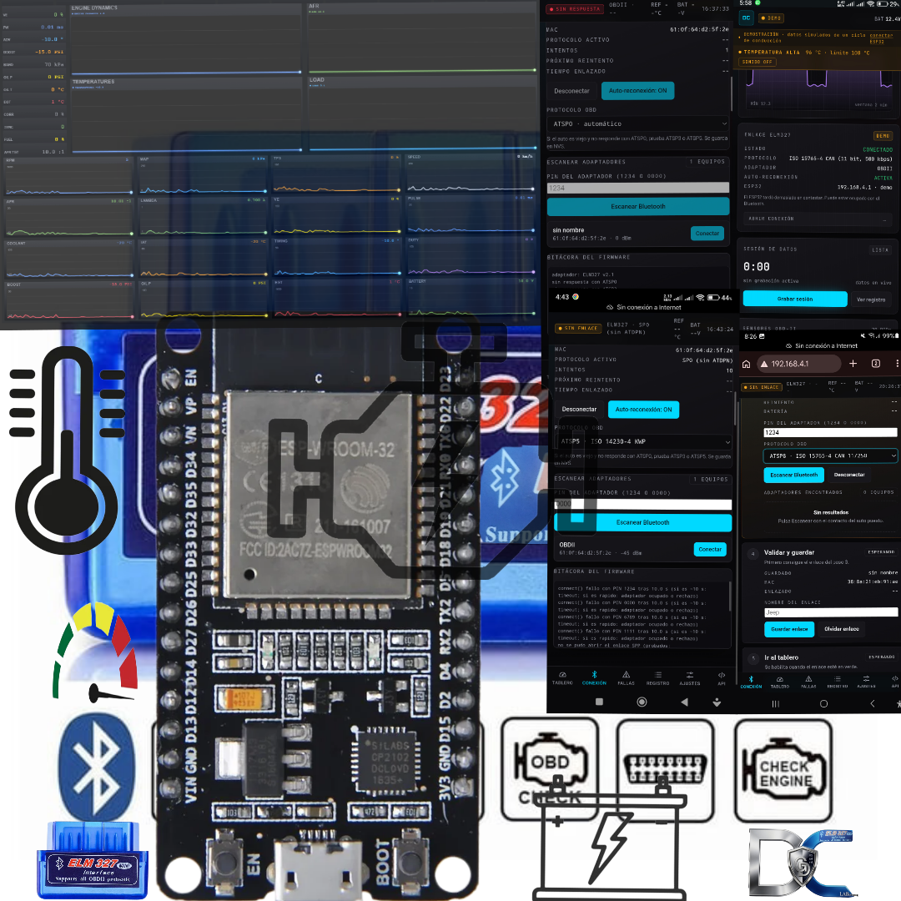

# espwroom327
🔗https://dcg0.github.io/espwroom327/

## Sitio informativo

La página de presentación está en [`docs/`](docs/), separada del firmware de `esp32-elm327/`. Incluye una demo OBD-II con valores simulados.

la contraseña es opvional solo es para prueba puedes cambiarla dejarla funcionara de todas maneras lo recomendable es una vez  probado cambiala solo prender el diapositivo esp32 cuando se haga el dignostico no se recomienda dejarlo encendido al apagar el auto puede seguir conectado y seguir mostrando el panel con datos reales 
